<div align="center">


<br><br>


<br><br>

**[Open the live demo](https://45-76-150-156.sslip.io)** and press **Try the demo**: no sign-up, a private copy for 7 days.

<br>

[How it works](#how-it-works-in-short) &nbsp;|&nbsp;
[See it work](#see-it-work) &nbsp;|&nbsp;
[Why it's safe](#why-a-business-can-let-it-run) &nbsp;|&nbsp;
[Vultr](#how-it-uses-vultr) &nbsp;|&nbsp;
[Benchmark](#reading-benchmark) &nbsp;|&nbsp;
[Set up](#setting-up-your-own-workspace) &nbsp;|&nbsp;
[Run locally](#run-it-locally) &nbsp;|&nbsp;
[Deploy](#deploy-on-vultr)

</div>

<br>

**Aerion** runs the weekly finance back office for Pakistani software houses and IT freelancers. It makes sure every payment arrives, is matched to an invoice, and counts as an IT export. **It never moves money.** The name comes from the Aerarium, the public treasury of ancient Rome.

Built for the lablab.ai × Vultr **Agent Rush** hackathon, Challenge 2 (Finance & Accounting: invoice processing, transaction reconciliation, anomaly flagging, payment follow-ups). It runs entirely on Vultr, live at **https://45-76-150-156.sslip.io**.

---

## How it works, in short

- **Who it's for.** Software houses and freelancers in Pakistan, who are paid by SWIFT wire, Payoneer or Wise because PayPal and Stripe don't pay out there. Each payment brings paperwork that decides how the income is taxed.
- **What it does.** Every Monday at 09:00 Pakistan time, and whenever new mail arrives, a worker runs one workflow per workspace. It reads the bank advices, wallet exports and client emails, matches the money to invoices, re-checks every rule, drafts the follow-up emails and tasks, and lists what needs a person.
- **Who decides.** Code makes every decision. A model only reads: minimax-m3.1-flash on Vultr Serverless Inference classifies documents and extracts their fields, and every value must quote its source text. Every number in an outgoing email is checked against the records twice.
- **What a person does.** Approves the emails (supervised is the default; autopilot is a setting), and does what software can't, like calling a client to confirm the bank details really haven't changed.
- **Where it runs.** On Vultr: Cloud Compute for the web app and the worker, Managed PostgreSQL for the records and the run queue, Object Storage for documents and backups, and Serverless Inference for reading. One command creates all of it through the Vultr API.

---

## The problem

<p align="center">
  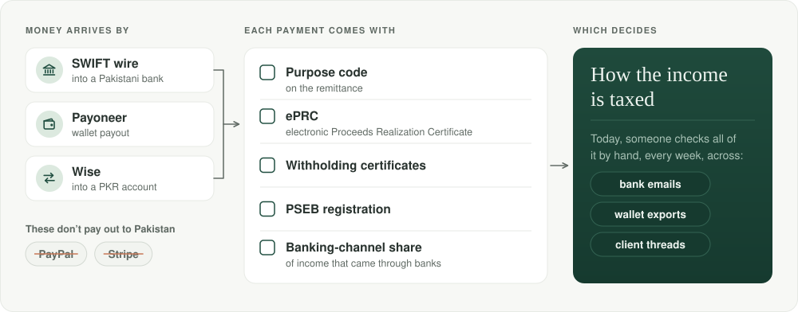
</p>

PayPal and Stripe don't pay out to Pakistan. Exporters get paid by SWIFT wire to a Pakistani bank, through Payoneer, or by Wise into a PKR account. Every payment comes with paperwork that decides how the income is taxed: the purpose code on the remittance, the electronic Proceeds Realization Certificate (ePRC), withholding certificates, PSEB registration, and the share of income that came through banks. Today someone checks all of this by hand, every week, across bank emails, wallet exports and client threads.

---

## What the agent does

Every Monday at 09:00 Pakistan time (or when someone presses **Run now**), the worker runs one workflow per workspace, from planning to output. Each card shows what that step did in the demo's first Monday run.

<p align="center">
  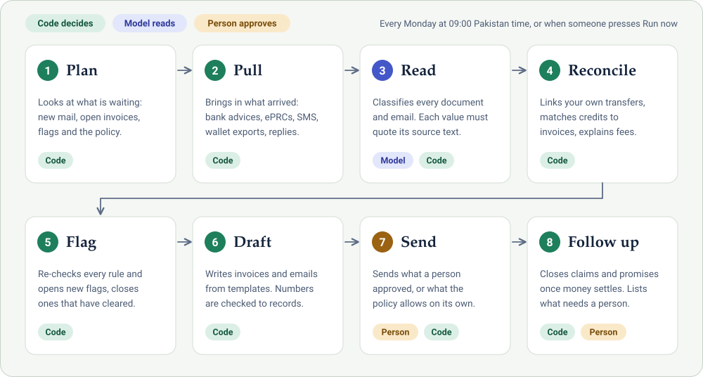
</p>

| Step | What happens |
| --- | --- |
| **Plan** | Looks at what is waiting (new mail, open invoices, open flags, the approval policy) and records what this run will do. |
| **Pull** | Brings in what arrived since the last run: bank credit advices, ePRCs, SMS alerts, Payoneer and marketplace exports, client replies. |
| **Read** | Classifies and extracts every document and email, including the ones people upload. CSV exports are parsed by code; PDFs are read from their text layer; the rest goes to Vultr Serverless Inference, and every extracted value must quote the source text. Anything that fails a check waits for a person. |
| **Reconcile** | Links transfers between the business's own accounts, matches each credit to invoices, explains bank fees and FX, and opens the ePRC and certificate items each credit needs. |
| **Flag** | Re-checks every rule: short payments, wrong purpose codes, missing ePRCs or certificates, overdue invoices, suspicious bank-detail changes, duplicates, a low banking-channel share, PSEB and ATL status, high FX spreads, broken promises to pay. It opens new flags and closes the ones that have cleared. |
| **Draft** | Drafts the month's invoice for each retainer whose billing day has come. Writes the emails (reminders, short-payment breakdowns, purpose-code corrections to the bank, "our bank details have not changed") and the internal tasks, from templates. Every number in a draft is checked against the records. |
| **Send** | Sends what a person approved, or what the policy allows on its own. |
| **Follow up** | Closes claims and promises that the money settled, and lists what needs a person. |

Each run is recorded step by step, and the run page shows what each step did and why.

---

## See it work

These are screenshots of the live demo, taken on 2026-11-08. The software house, its clients and its money are sample data, and the bar at the top shows the demo's simulated clock.

### Monday morning: what needs a person

<p align="center">
  
</p>

After its first Monday run (the demo clock says Mon 2 Nov 2026, 09:00), nine things need a person: six emails to approve and three tasks, such as calling a client to confirm the bank details. The Action Center lists them by priority, high first, each with one next step and how many of its numbers were checked against the records. The tiles and the chart come from the same books, and each insight links to the record behind it. Nine flags are open, four of them high.

### Every step on the record

<p align="center">
  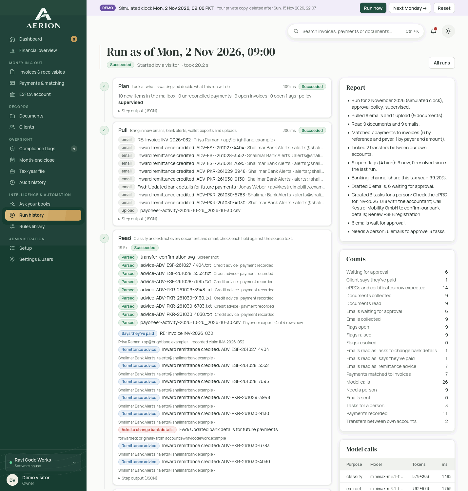
</p>

Each run has its own page: what every step did and how long it took, and every model call with its tokens and time. This run took 20.2 seconds, 19.5 of them in the Read step, where Serverless Inference read the documents and emails in 26 model calls. Every other step took milliseconds.

### Every number traced

<p align="center">
  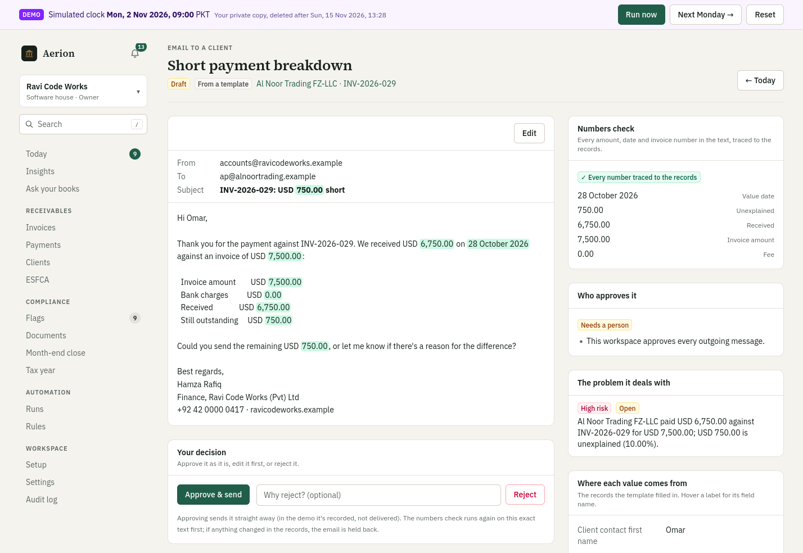
</p>

In a draft, every number is highlighted and traced to a record: the value date, the amount received, the invoice amount, the fee and the unexplained difference. Approving runs the check again on the exact text, and holds the email back if anything in the records has changed. In the demo, an approved email is recorded, not delivered.

### Next Monday, flags close on their own

<p align="center">
  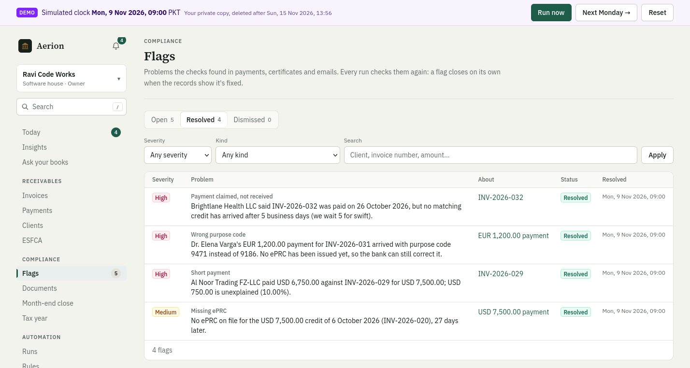
</p>

Once the emails have gone out, **Next Monday →** lets that week's replies arrive and runs again. The rest of Al Noor's payment comes in, the bank corrects the purpose code, Brightlane's money lands and the missing ePRC arrives, so four flags close on their own. Five stay open: the lookalike-domain warning, with a task for a person to call the client, and four medium flags. Three of the five are already being handled.

---

## More than the Monday run

### Financial overview

The **Financial overview** shows, for the tax year so far:

- what clients owe, by how late it is, and the most overdue invoices
- how many days invoices take to get paid
- what getting paid costs on each route: fees, plus conversion below the reference rate
- export proceeds banked in Pakistan, by month
- each client's record

It uses the same books and reference rates as the run. Every chart has its numbers in a table underneath.

### Ask your books

Ask in plain words: *What does Al Noor owe? How much came in last month? Which ePRCs are still missing? Who pays late? Where is INV-2026-029?* Aerion turns the question into one of nine read-only queries (owed, overdue, received, proceeds by month, banking-channel share, missing paperwork, cost of getting paid, days to pay, one invoice), and code works out the answer from the same books as the financial overview, with every line linked to the record behind it.

<p align="center">
  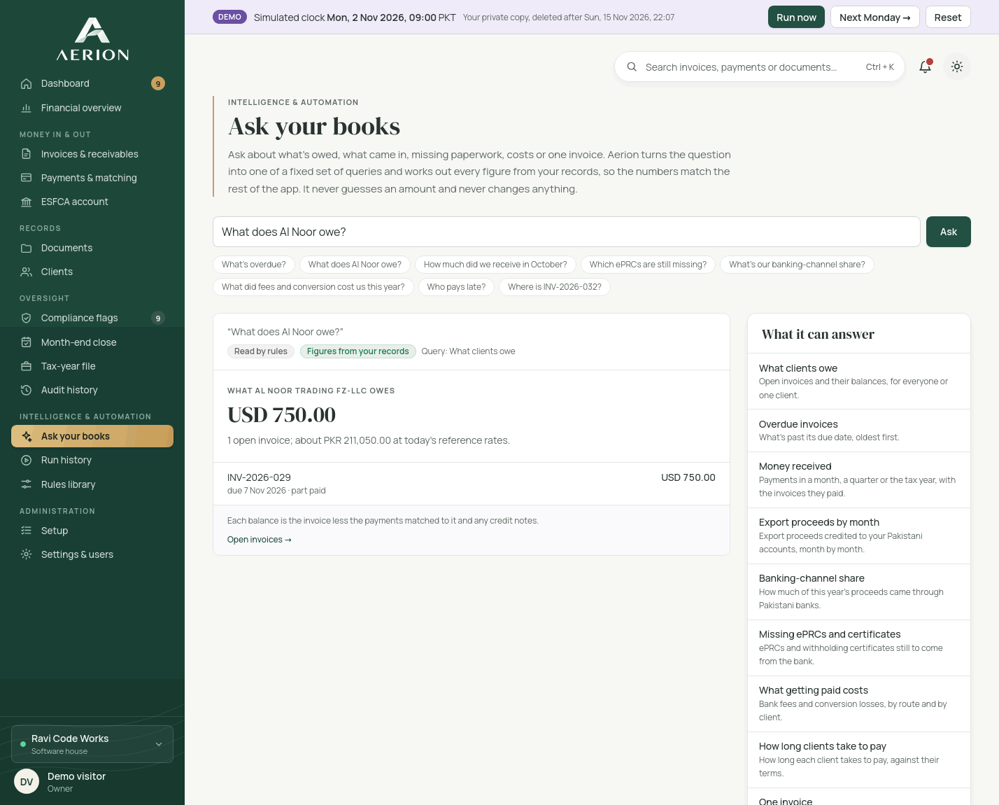
</p>

Built-in rules read the question first. Only when they can't place it, and only where the workspace allows AI, minimax-m3.1-flash on Vultr Serverless Inference chooses the query from the question, today's date and the client names: never amounts or documents. Aerion checks that choice (a real query, a client and invoice that exist, real dates) before using it, and every answer says whether the rules or the model chose the query. The model never writes a number, model questions are capped per workspace per day, and each call is recorded with its tokens and cost.

### Credit notes, write-offs and voids

On an invoice, a person can record a **credit note**, a **write-off** or a **void**, each with a reason. They are numbered `CN-`, `WO-` and `VD-` per year. The balance and every report follow at once:

- flags about the invoice that no longer hold are resolved
- an open dispute is closed by the credit
- emails waiting to go out are either held (the next run redrafts them with the new balance) or cancelled when no longer needed

A void is only possible before any money has come in. Its PDF then says VOID.

### Tax-year file and year-end tax pack

The **Tax-year file** page exports the year's credits and the banking-channel share as CSV for the accountant, for the current tax year or any earlier one.

Its **year-end tax pack** is one zip for the accountant.

<p align="center">
  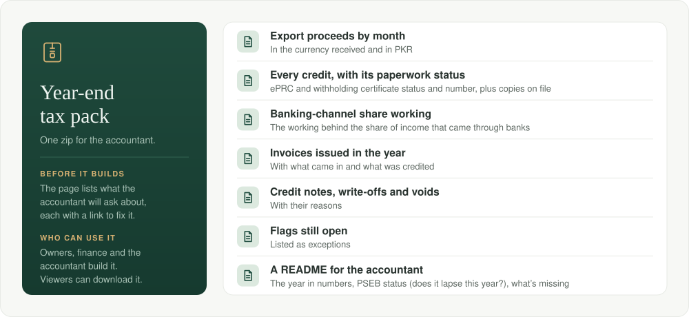
</p>

Before building it, the page lists what the accountant will ask about, each with a link to sort it out. Each pack is kept in storage (Object Storage in production) and can be downloaded again later. Viewers can download packs; owners, finance and the accountant can build them.

<details>
<summary><b>Full contents of the pack</b></summary>

<br>

- the year's export proceeds by month, in the currency received and in PKR
- every credit with its ePRC and withholding certificate status and number, plus copies of the certificates on file
- the banking-channel share working
- the invoices issued in the year, with what came in and what was credited
- the credit notes, write-offs and voids, with their reasons
- the flags still open, as exceptions
- a README with the year in numbers, the PSEB registration (and whether it lapses before the year ends), and what's missing

</details>

### Month-end close

**Month-end close** (offices; under Month-end) has a checklist for each month that's over:

- every credit matched to an invoice or explained as a transfer
- every certificate the bank owes on file, or on its way
- each bank account's statement agreeing with the records
- every flag about the month looked at
- every document read

Each line is done, waiting on someone outside (the bank, a client), or to do, with a link to where to sort it out. When nothing is left to do, **Close** makes a month-end report PDF for the director: money received, proceeds banked in Pakistan, invoices issued, what was owed at month end by age, the statement balances, the checklist, and what was still waiting. If the month's records change afterwards, the page says so, and the owner can reopen it with a reason.

**Bank statements** (CSV with the bank's columns) are read by code. Every running balance must follow from the line before, or the statement goes to a person. Each credit on the statement is tied to the credit already on record from the bank's advice; a credit the bank shows but no advice did is added, so the run can match it. In the demo, July to September were closed before it begins. October can be closed after the Monday run:

1. Press **Run now**, then approve the six emails on the **Dashboard**.
2. Mark the task "Check the ePRC for INV-2026-018 with the accountant" done. A finished task, like an approved email, marks its flag as being handled.
3. On **Month-end → October 2026**, press **Upload sample statements** (SIMULATED, made from the books).
4. Press **Close October 2026**.

---

## Why a business can let it run

<p align="center">
  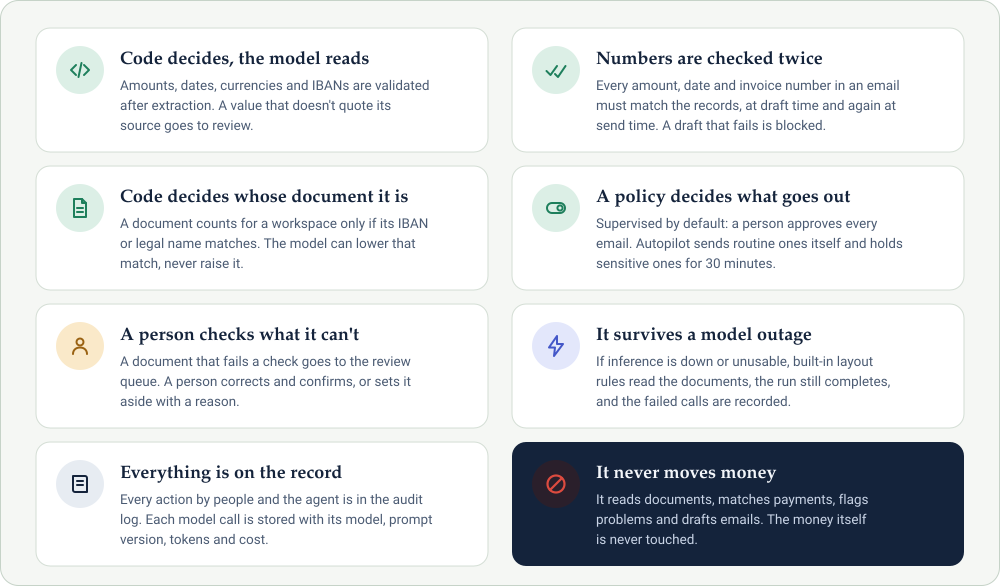
</p>

### Who approves what goes out

<p align="center">
  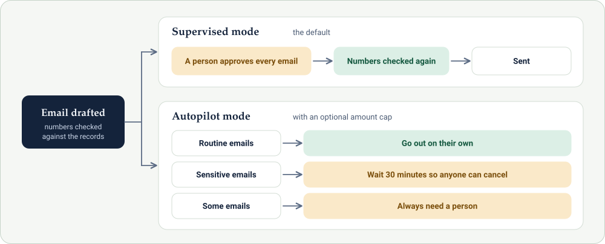
</p>

<details>
<summary><b>Read the details behind each safeguard</b></summary>

<br>

- **Code decides, the model reads.** Amounts, dates, currencies and IBANs are validated after extraction. A value that doesn't quote the source text, or doesn't parse, is marked for review instead of being used.
- **Numbers are checked twice.** Every amount, date and invoice number in an outgoing email must match the records, both when the email is drafted and again at send time. A draft that fails is blocked and never sent.
- **Code decides whose document it is.** A document only counts for a workspace if its IBAN or legal name matches. The model can lower that match, never raise it.
- **A person can rewrite any email before it goes.** Approve, edit or reject. An edited email gets the same numbers check as the agent's draft, a number that doesn't trace to the records holds it, and a later run keeps the person's words. The audit log keeps the text it replaced.
- **A policy decides what goes out.** In *supervised* mode (the default), a person approves every email. In *autopilot* mode, routine emails go out on their own, sensitive ones wait 30 minutes so anyone can cancel them, some always need a person, and there is an optional amount cap.
- **A person checks what the agent can't.** A document that fails a check (an account that isn't the workspace's, an amount that doesn't parse, a date after the document arrived, a scan with no text) goes to the review queue. A person corrects the fields beside the document and confirms, or sets it aside with a reason. The confirmed values go through the same checks as anything the model reads, and the audit log records who changed which field.
- **The workflow survives a model outage.** Calls that hit a rate limit or a server error are retried with backoff, and an unusable reply gets one more try that says what was wrong. After that, the reader falls back to the built-in layout rules. The run still completes, and the failed calls are recorded on its page.
- **Everything is on the record.** The audit log records every action by people and by the agent. Each model call is stored with its model, prompt version, tokens and cost. Running twice at the same clock changes nothing.

</details>

---

## Setting up your own workspace

Open any item for the full detail.

<details>
<summary><b>Create an account</b>: then a workspace. It starts empty.</summary>

<br>

Create an account, then a workspace for a software house or a freelancer. It starts empty: nothing in it is simulated. Sign-up records the pilot terms and, separately, whether documents may be read by a model; without that consent the workspace uses the built-in layout rules only.

</details>

<details>
<summary><b>Setup</b>: invoice details, receiving accounts, numbering.</summary>

<br>

**Setup** takes what goes on invoices (legal name, NTN, PSEB registration and expiry, ATL status, the email signature), the accounts money arrives in (ESFCA, PKR account, Wise, Payoneer; Pakistani IBANs are checked down to the check digits) and the invoice numbering. A checklist shows what is left. Only owners change these.

</details>

<details>
<summary><b>Clients</b>: currency, terms, usual route, payer names.</summary>

<br>

**Clients** holds each client's currency, payment terms, usual payment route and the payer names their money arrives under. The matcher learns more names as it goes.

</details>

<details>
<summary><b>People</b>: invite finance or an outside accountant, by role.</summary>

<br>

An owner invites their finance person or outside accountant by email, with a role. The link works once, only for that address, for 7 days, and only a hash of it is stored. Owners can change roles or remove people, and a workspace always keeps at least one owner.

</details>

<details>
<summary><b>Mailbox</b>: Gmail, Google Workspace, Zoho or any IMAP and SMTP host.</summary>

<br>

Connect the finance mailbox (Gmail, Google Workspace, Zoho or any IMAP and SMTP host) with an app password. Both logins are tested before anything is saved, and the password is stored encrypted (AES-256-GCM). Each run then reads the mail that arrived since the last one, read-only, and keeps attachments as documents. The worker checks for new mail every 15 minutes and starts an "on arrival" run when some has come in, so the agent doesn't wait for Monday. Approved emails go out through the same mailbox. Bank SMS alerts can be pasted on the Documents page.

</details>

<details>
<summary><b>Invoices</b>: written in the app, with a payment-route suggestion and a PDF.</summary>

<br>

Invoices are written in the app. The editor suggests how the client should pay and says why (for example, that their last bank wire lost USD 25.00 to fees). Numbers continue after the highest one used. The A4 PDF quotes the exact payment instructions and the purpose-of-payment wording the bank needs to report the money as an IT export. Emailing an invoice goes through the approval inbox like every other email: the numbers check runs, the PDF is attached, and the copy that was sent is kept on file.

</details>

<details>
<summary><b>Retainers</b>: the month's invoice is drafted once the billing day comes.</summary>

<br>

On a client's page, add the amount they pay each month and the day it's billed. Once that day comes, the next run drafts the month's invoice (dated the billing day, with the suggested route) and the email that sends it, and both wait in the inbox. Each month is drafted once, editing the draft doesn't make a second one, and earlier months are never back-filled. If a month can't be drafted (say, no account takes that currency any more), a task asks a person to fix it and the next run tries again. **Stop** ends the drafts, including a month that's due but not drafted yet.

</details>

<details>
<summary><b>Imports from spreadsheets</b>: clients, open invoices, opening balances.</summary>

<br>

**Imports from spreadsheets** (Import, linked from Clients, Invoices, Setup and the tax-year file): CSV templates for clients, open invoices and opening balances, each with two example rows. Usual other headings (Customer, Invoice No, Amount (USD)) are understood, dates are read day first, and every row is checked before anything is saved: problems are listed by spreadsheet row and column, and an import is all or nothing. Open invoices come in as sent, with money already paid taken off what's owed. Opening balances are this tax year's proceeds from before the records began; they count in the banking-channel share and the PSEB estimate. The file is kept as a document.

</details>

<details>
<summary><b>ESFCA</b>: balances, conversions and retention.</summary>

<br>

**ESFCA** (in the sidebar when the workspace has one): the balance, from the newest statement plus movements since, or from recorded movements until one is read. Each conversion the bank has made is recorded with its rate and cost against the reference rate; the product never converts money itself. The rupees on the PKR statement are tied to the conversion and don't count as export proceeds a second time. A month-by-month retention check applies rule 9, marked unverified until someone checks the State Bank source.

</details>

<details>
<summary><b>Notifications</b>: what needs each person, plus an email digest.</summary>

<br>

**Notifications** (in the sidebar, with a count of what's new): approvals, tasks, high-risk flags, documents to check and payments to place, filtered to what each person's role can act on, with a task given to someone going only to them. Items someone has dealt with leave the count on their own. The **email digest** is the same list, every morning or on Mondays from 09:00, sent through the workspace's connected mailbox and only when something needs that person. Owners and finance get it daily unless they change it; accountants and viewers can turn it on. Each person sets their own, the page shows what today's would say, and it never lands in a client's message history.

</details>

<details>
<summary><b>Two-factor sign-in</b>: authenticator codes, which an owner can require.</summary>

<br>

**Two-factor sign-in:** under *Your account*, anyone with a password can add a code from an authenticator app (scan the QR code, keep the ten backup codes, enter the first code to finish). After that, signing in asks for the code after the password, with an option to trust the device for 30 days; a backup code works once if the phone is lost. An owner can require it for owners and finance, who approve what goes to clients and banks: in Settings they see who has it, and anyone without it is sent to set it up before they can open the workspace. Each sign-in allows 5 wrong codes, 10 wrong codes lock the account for 15 minutes, and 10 wrong passwords for one address from one place pause sign-in for 15 minutes. Turning it on or off is in every workspace's audit log. The shared demo accounts can't turn it on, so nobody can lock the others out.

</details>

<details>
<summary><b>Your data</b>: full export, and deletion.</summary>

<br>

**Your data** (Settings → Export or delete, owners only): **Build the export** makes one zip with every record of the workspace, as JSON (amounts as exact text, times in UTC) and as a spreadsheet per table, plus every document file with an index tying each to its record. It's read from one consistent snapshot and kept in storage to download again. The mailbox password, invitation links and people's sign-in details stay out. **Delete this workspace** takes the workspace's name typed out and the owner's password, then removes every record, file and export, the audit log included. Demo workspaces are reset instead.

</details>

---

## How it uses Vultr

<p align="center">
  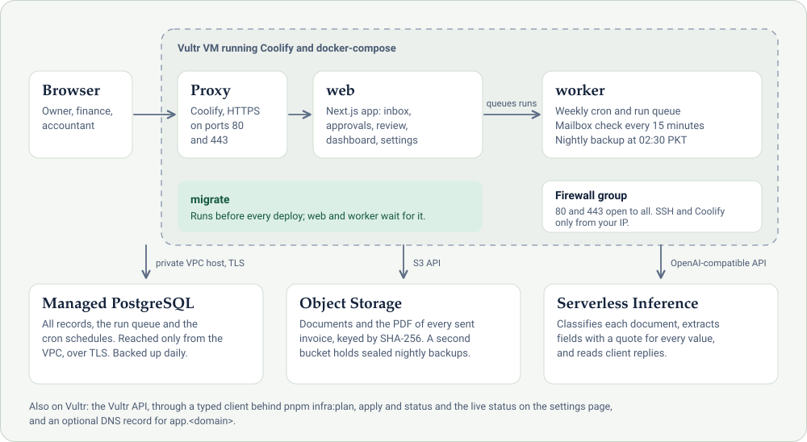
</p>

The live demo runs on this stack in Singapore (`sgp`), created by `pnpm infra:apply` and deployed by Coolify from this repository.

| Vultr service | What it does here |
| --- | --- |
| **Cloud Compute** (Coolify marketplace image) | One VM (`vc2-2c-4gb` in the live demo) runs the app as three containers from `docker-compose.yml`: `migrate` runs the migrations before every deploy, `web` serves the Next.js app, and `worker` runs the workflow and the schedules. A firewall group opens 80/443 to everyone, and SSH and the Coolify dashboard only to your IP. Daily VM backups run at 02:00 PKT. |
| **Managed Databases for PostgreSQL** | PostgreSQL 17. Holds all records: invoices, transactions, matches, flags, drafts, the audit log, sign-in sessions, the run queue and the cron schedules (pg-boss). It's reached over the VPC's private hostname, only from the VPC, with TLS (verified when `DATABASE_CA_CERT` is set), and backed up daily. |
| **Object Storage** | Stores the documents (credit advices, ePRCs, screenshots, wallet exports and uploads) and the PDF of every invoice as it was sent, through the S3 API, keyed by SHA-256, so the same file is never stored or counted twice. A second bucket holds the nightly database backups. At 02:30 PKT the worker writes every table from one consistent snapshot as a gzipped file sealed with AES-256-GCM, and keeps the newest 14. |
| **Serverless Inference** | Reads documents and emails through the OpenAI-compatible API with `minimax-m3.1-flash`, chosen by the [reading benchmark](#reading-benchmark): it classifies each document, extracts its fields with JSON output and a quote for each value, and reads client replies for promises to pay and claims of payment. Each call is stored with its tokens, time and cost. |
| **Vultr API** | `packages/vultr` is a typed client generated from Vultr's OpenAPI document (`openapi-typescript` + `openapi-fetch`). `pnpm infra:plan / apply / status` uses it to create the whole stack. The settings page uses it to show live status: VM, backups, database, storage, and model usage and cost. |
| **DNS** (optional) | If `DOMAIN` is a Vultr DNS zone, `infra:apply` adds an A record for `app.<domain>`. Without one, the address is the VM's IP under `sslip.io`, which still gets a real certificate, as the live demo does. |

<details>
<summary><b>Text version of the diagram</b></summary>

<br>

```
Browser ── HTTPS ──▶ Coolify proxy ──▶ web (Next.js) ──── queues runs ───▶ worker (pg-boss cron + run queue)
                                       │ dashboard, approvals,              │ plan → pull → read → reconcile
                                       │ review, settings                   │ → flag → draft → send → follow-up
                     Vultr VM (Coolify, docker-compose)                     │
          ┌────────────────────────────┴──────────────┬─────────────────────┴───────────────┐
          ▼                                           ▼                                     ▼
  Managed PostgreSQL                          Object Storage                       Serverless Inference
  records, run queue, schedules,              documents (S3 API),                  classify, extract, read replies
  audit log (private VPC host, TLS)           sealed nightly backups               (minimax-m3.1-flash, JSON)
```

</details>

---

## Reading benchmark

<p align="center">
  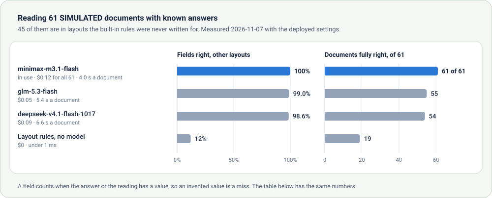
</p>

The model is chosen by measurement. `pnpm bench` has every reader read the answer key: 61 SIMULATED documents, each with the values it should yield, taken from the generator's own inputs so the key can't drift from the files. 16 are in the demo bank's layout. The other 45 show the same facts in layouts the built-in rules were never written for: another bank's advice, a letter, a noisy scan, other SMS wording (one in Roman Urdu), another app's screenshot and a printed MT103. Three advices are addressed to someone else. A field counts when the answer or the reading has a value, so an invented value is a miss.

| Reader | Fields right, demo layout | Fields right, other layouts | Documents fully right | Cost for all 61 | Median per document |
| --- | --- | --- | --- | --- | --- |
| Layout rules (no model) | 100% | 12% | 19 of 61 | $0 | under 1 ms |
| **minimax-m3.1-flash** (in use) | 100% | 100% | 61 of 61 | $0.12 | 4.0 s |
| glm-5.3-flash | 100% | 99.0% | 55 of 61 | $0.05 | 5.4 s |
| deepseek-v4.1-flash-1017 | 100% | 98.6% | 54 of 61 | $0.09 | 6.6 s |

Measured on 2026-11-07 with the deployed settings. These models reason before they answer, and the reasoning counts against the token limit. An earlier run with a limit of 2,000 tokens cut that reasoning off and scored all three lower in other layouts (97.3%, 92.6% and 87.9%), so the limits now leave room for it. minimax-m3.1-flash reads documents and emails on the deployed site. It also gave the same demo result on every repeated run. The documents are the team's own simulated ones, so the table compares the models; it doesn't promise the same accuracy on real bank mail.

The model rows come from `pnpm bench --models candidates`, which needs `VULTR_INFERENCE_API_KEY`. It runs every candidate model the key can use and reports tokens, cost and time per document; add `--out <dir>` to save the report. A test checks that the layout rules read every demo document exactly as the key says, and that a model which can't be reached counts as a miss rather than borrowing the rules' answer.

---

## Try the demo

Open **https://45-76-150-156.sslip.io** and press **Try the demo**. All data is fictional and marked SIMULATED: a software house (Ravi Code Works) and a freelancer (Ayesha Siddiqui), with their invoices, bank documents, wallet exports and client emails.

- **Try the demo** gives you a private copy of both workspaces for 7 days (no sign-up). If you then create an account, the copy stays with you until it expires.
- Each demo workspace has its own clock. **Run now** runs the workflow at the current clock; on the live site, Serverless Inference does the reading, so the first Monday's run takes about 20 seconds. **Next Monday →** moves the clock to the next Monday 09:00 PKT, lets that week's replies arrive, and runs the weekly workflow. **Reset** starts again.
- On **Documents**, upload your own files (PDF, CSV, text or an image, up to 10 at a time), or press **Upload a sample credit advice**. The sample is a SIMULATED bank advice for the oldest open invoice: the run reads it, matches it and marks the invoice paid. Uploads that fail a check appear under **Need a person**, where you can correct and confirm them.
- In the software house, the first Monday (2 Nov 2026) produces 6 emails to approve, 9 flags and the tasks for a person. After you approve the emails, the next Monday's replies close four flags and mark the short-paid invoice paid. The bank that didn't send a withholding certificate gets a phone-call task.
- In the freelancer's workspace, the same Monday matches two payments and leaves two emails to approve: the purpose-code correction to her bank, and the one sending Harbor & Pine's November retainer invoice (USD 2,400, billed on the 1st). The agent drafted that invoice itself because the billing day had come.

### Shared demo accounts

Created by `pnpm seed`, with the password set in `DEMO_PASSWORD`.

| Account | Role |
| --- | --- |
| `sana@ravicodeworks.example` | Owns the software house |
| `hamza@ravicodeworks.example` | Does the software house's finance |
| `qureshi@qureshi-associates.example` | Outside accountant for both workspaces (read-only, except for building tax packs) |
| `ayesha@ayeshabuilds.example` | The freelancer |

> [!NOTE]
> **What's simulated in this build:** in the demo workspaces, the mailbox, bank alerts and wallet exports are sample data that "arrive" as the demo clock moves, and sending only records the email. A workspace you create can connect a real mailbox (IMAP in, SMTP out). There's no live connection to a bank or to Payoneer; their documents come in by email or upload.

---

## Run it locally

Needs Node 22+ and pnpm 10. No Docker is needed: the database is an embedded PostgreSQL.

```bash
pnpm install
cp .env.example .env     # set BETTER_AUTH_SECRET (openssl rand -hex 32) and DEMO_PASSWORD
pnpm dev:db              # in its own terminal: local PostgreSQL on port 54329, small-memory settings
pnpm db:migrate
pnpm seed                # the shared demo workspaces and users
pnpm local               # http://localhost:3000, a production build using about 200 MB of memory
```

`pnpm local` builds the app (again only when the source changes) and runs the workflow inside the web process, so no worker is needed. For hot reload while coding, use `pnpm dev` (the web app only, and much heavier), or `pnpm dev:all` to run the worker as well. Every command reads the `.env` at the repo root; variables already set in your shell win. Without `VULTR_INFERENCE_API_KEY`, documents are read by the built-in layout rules. With a key, `pnpm --filter @ebo/ai models` lists the models it can use. Set `VULTR_INFERENCE_MODEL` to choose one (the default is `minimax-m3.1-flash`), and `pnpm --filter @ebo/ai try <file>` reads a single document with it. `pnpm bench` scores the readers against the answer key.

```bash
pnpm typecheck
pnpm test                # unit tests, plus the full workflow against the local database
pnpm --filter @ebo/worker cli run ravi-code-works   # run one workspace from the terminal
```

---

## Deploy on Vultr

<p align="center">
  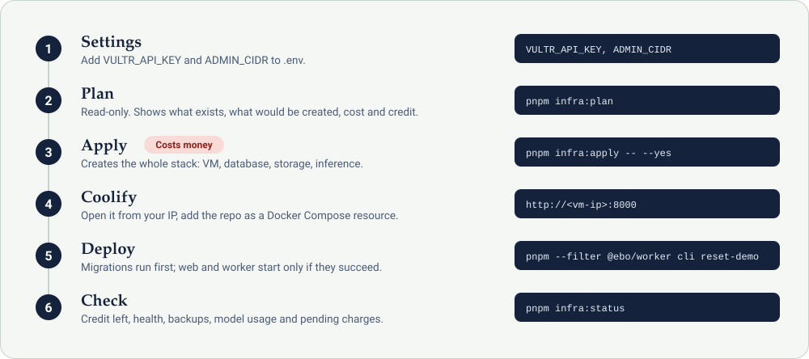
</p>

> [!WARNING]
> `pnpm infra:apply` creates paid resources. `pnpm infra:plan` is read-only and shows the monthly cost first.

1. **Settings.** Put `VULTR_API_KEY` and `ADMIN_CIDR` (your IP) in `.env`, plus optionally `VULTR_REGION` (default `sgp`), `DOMAIN` and `SSH_PUBLIC_KEY_PATH`. The key comes from Account, API in the Vultr portal, where you also add your IP under Access Control, or Vultr refuses the calls.
2. **Plan.** `pnpm infra:plan` is read-only. It shows what already exists, what would be created, the monthly cost, and how long the account's Vultr credit lasts with the new resources.
3. **Apply.** `pnpm infra:apply -- --yes` creates what's missing: the SSH key, VPC, firewall group, VM with Coolify, Managed PostgreSQL, Object Storage with its buckets, the Serverless Inference subscription and the optional DNS record. Resources are found by label, so running it again is safe. Everything Coolify needs goes to `.env.vultr` (secret, gitignored): the connection details, plus the app's secrets, generated once and kept on every re-run. *This step costs money.*
4. **Coolify.** Open `http://<vm-ip>:8000` from your IP and create the admin account. Add this repository as a **Docker Compose** resource and paste `.env.vultr` into the environment variables. Give the `web` service the address in `BETTER_AUTH_URL` on port 3000, such as `https://app.example.com:3000`. Without a `DOMAIN`, that address is the VM's IP under `sslip.io`, which can still get a certificate. Optionally add these:
   - `VULTR_API_KEY` for the live status on the settings page (restrict the key to the VM's IP)
   - `DATABASE_CA_CERT` (the database's CA certificate, `\n` for line breaks) to verify the database's certificate
5. **Deploy.** The migrations run first; `web` and `worker` start only if they succeed. Load the shared demo from the worker's terminal in Coolify: `pnpm --filter @ebo/worker cli reset-demo`.
6. **Check.** `pnpm infra:status` shows the credit left and how many days it lasts at this month's spending rate, plus health, backups, model usage and pending charges. The settings page shows the same credit line, in amber when it's under USD 25 or 14 days.

> [!IMPORTANT]
> Keep a copy of `APP_ENCRYPTION_KEY` off the server. Without it, neither the mailbox app passwords nor the nightly backups can be opened.

Without Object Storage, documents and backups go to a Docker volume shared by `web` and `worker`. The worker runs every queued run. `RUNS_INLINE=1` (run the workflow inside the web process) is for local development and is safe alongside a worker.

### Backups and restore

The worker backs up the database every night to the backups bucket (`S3_BUCKET_BACKUPS`, from `infra:apply`), on top of the managed database's own daily backups and the VM's. Each backup is one file: every table, read from one consistent snapshot, with each row written by Postgres as JSON. It is gzipped and sealed with AES-256-GCM using a key derived from `APP_ENCRYPTION_KEY`. Values come back exactly, and no `pg_dump` has to match the server's version. From the worker's terminal, or locally (backups go to `./.backups`):

```bash
pnpm backup                                   # back up now, as the nightly job does
pnpm backup:list
pnpm backup:restore latest postgres://…/new   # into a new database: migrated first if blank; refuses one with data
```

The restore drill runs as a test (`packages/engine/test/backup.test.ts`). It backs up the whole database, restores it into a new one, and checks that every row came back identical. It also checks that a restore refuses a database with data, one from another release, the wrong key and a damaged file.

---

## Repository

| Path | What's in it |
| --- | --- |
| `apps/web` | Next.js app: landing page, sign-up and sign-in, setup, the dashboard, the financial overview, Ask your books, search, runs, flags, payments, clients, invoices (editor and PDF), documents, tax-year file, rules, settings, audit log |
| `apps/worker` | Claims queued runs, runs the weekly cron, the mailbox check, the nightly backup and the demo clean-up, and has a CLI (runs, demo reset, backup and restore) |
| `packages/engine` | The workflow: the eight steps, the offline document readers, PDF text, uploads and the sample credit advice, sending; workspace setup, clients, invoices with their PDF, retainers, credit notes and write-offs, people, the mailbox, the dashboard and overview figures, Ask your books, and backups |
| `packages/core` | Pure rules: money, dates, matching, flags, templates, the numbers check, the approval policy |
| `packages/ai` | The Vultr Serverless Inference client, prompts, extraction schemas, model-backed readers, the question planner for Ask your books, and the reading benchmark |
| `packages/db` | Drizzle schema and migrations, storage (Object Storage or local), the demo data and its answer key |
| `packages/vultr` | A typed Vultr API client generated from the OpenAPI document, plus platform status |
| `infra` | `plan`, `apply` and `status` for the Vultr stack |
| `assets` | The images in this README. The screens are drawn from the live demo's pages. |

To regenerate the Vultr client, download Vultr's OpenAPI document to `packages/vultr/openapi.json` (it's gitignored) and run `pnpm vultr:types`.

This README is also published as the [project page](https://ob1-studios.github.io/Aerion/) on GitHub Pages (`.github/workflows/pages.yml`, built by `scripts/build-site.mjs`). It's only this page: the app needs a server and a database, so it runs on Vultr.

---

## License

MIT
